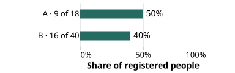
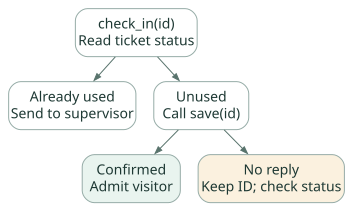

# Reader-first Writing

Turn source material into a document its readers can use. A coordinator deciding whether to extend a pilot needs the attendance rate and its denominator. A volunteer at the door needs to know when to stop admitting people. Both can use the same page when the instructions come first and the chart sits beside the pilot results.

## What it produces

**A pilot brief.** Group A had fewer visitors but a higher attendance rate. The chart shows both denominators. One session gives the coordinator a comparison, with too little evidence to predict future turnout.



**A code walkthrough.** In the example below, the door operator needs to know when it is safe to admit someone. The important detail is whether saving the ticket was confirmed. A missing reply sends the operator back to check the existing ID.



Both figures were drawn by the bundled module. [View the chart source](assets/figures/attendance.vl.json), [inspect the diagram source](assets/figures/check-in.dot), or [compare earlier generated pages and their reading trials](evals/README.md).

## Try it

Install the repository as a directory named `reader-first-writing` in your agent’s skill root, or copy its runtime files as shown below. The writing instructions are plain Markdown. The document can be in the language requested by the reader.

| Agent | Project installation | Invocation |
|---|---|---|
| [Codex](https://developers.openai.com/codex/skills/) | `.agents/skills/reader-first-writing/` | `$reader-first-writing` followed by the request |
| [Claude Code](https://code.claude.com/docs/en/skills) | `.claude/skills/reader-first-writing/` | `/reader-first-writing` followed by the request |
| [DeepSeek Harness](https://github.com/deepseek-ai/deepseek-harness/blob/master/packages/skill/skill-filesystem/README.md) | `.dsh/skills/reader-first-writing/` or the shared `.agents/skills/` root with the filesystem provider enabled | Ask the agent to use the named skill |

From this repository, replace the destination with your project:

```sh
dest="../my-project/.agents/skills/reader-first-writing"
mkdir -p "$dest/scripts/figures"
cp SKILL.md LICENSE "$dest/"
cp -R references assets "$dest/"
cp scripts/figures/*.json scripts/figures/render.mjs "$dest/scripts/figures/"
```

> Turn these field notes into a handover for a first-time operator. They will use a phone. Keep every condition that changes whether they should stop.

> Write a design review for engineers new to this service. Show where a timeout leaves the operation undecided. Use the function names from the supplied code.

## How figures fit the document

The skill chooses whether a visual will help, which question it should answer, and where the reader will need it. It can keep an existing figure, replace one with a short table, or draw a new one. The bundled drawing module produces editable data charts and code diagrams as SVG. Its CLI uses Node.js 22.12 or later and needs a one-time install:

```sh
(cd scripts/figures && npm ci --ignore-scripts)
node scripts/figures/render.mjs assets/figures/attendance.vl.json attendance.svg
node scripts/figures/render.mjs assets/figures/check-in.dot check-in.svg
```

To choose a different renderer, name it in the request, for example “Use Mermaid for the sequence diagram and include the rendered image.” The writer still checks the evidence, caption, placement and final viewing size. For simple figures in environments without Node, the instructions also cover local HTML or SVG. [Drawing workflow and formats](references/rendering.md)

## When to choose it

[Humanizer](https://github.com/blader/humanizer) is a good fit for an existing article that needs to retain the author’s voice while losing formulaic prose. Choose Reader-first Writing when the editor must also decide which facts, exceptions and visuals belong in a report, a technical review or a field guide. [Examples across audiences and locales](examples.md)

## Help improve it

Ask a reader to make the intended decision without seeing your prompt. If they miss a condition or misread a figure, share the smallest example you have permission to publish, the target language and device, and what the reader understood. Examples where simpler instructions worked just as well are welcome. [Submit a reader case](.github/ISSUE_TEMPLATE/reader-case.md) · [Public test materials](evals/README.md)

The package follows the [Agent Skills format](https://agentskills.io/specification). Original instructions, renderer wrapper and fixtures use the [MIT license](LICENSE). The drawing libraries retain their own licenses.
